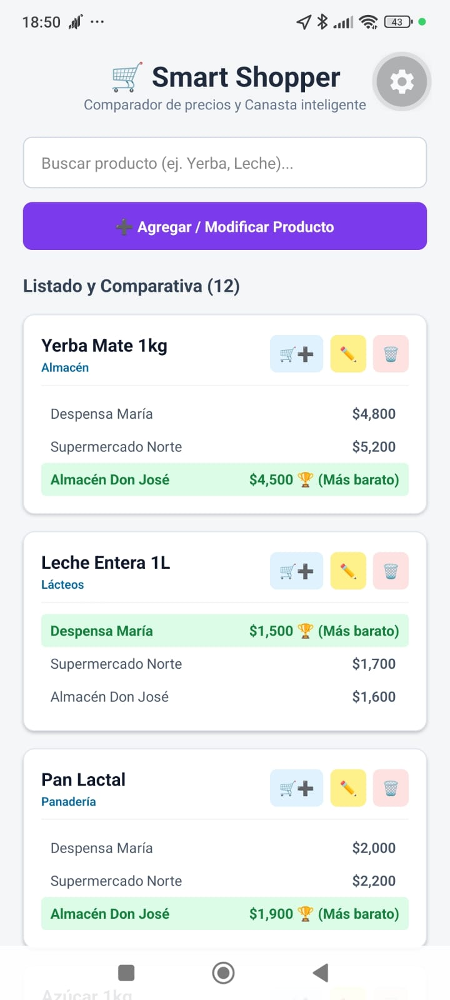
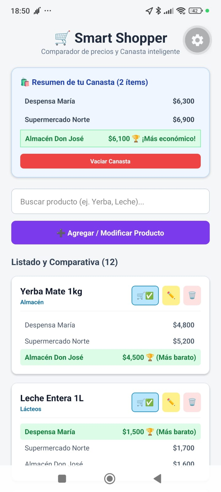
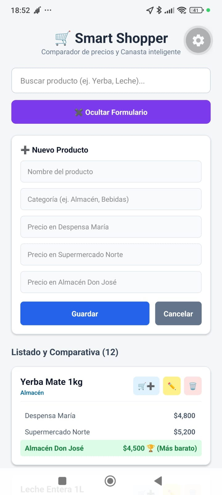
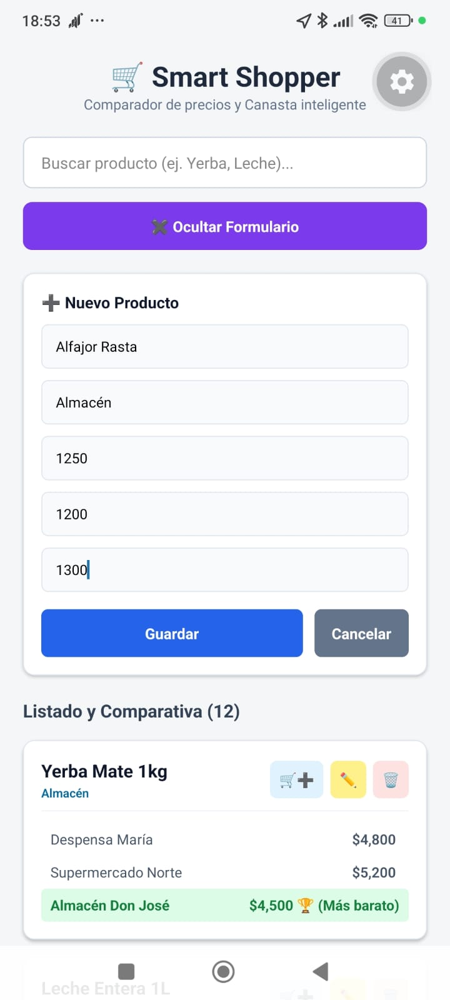
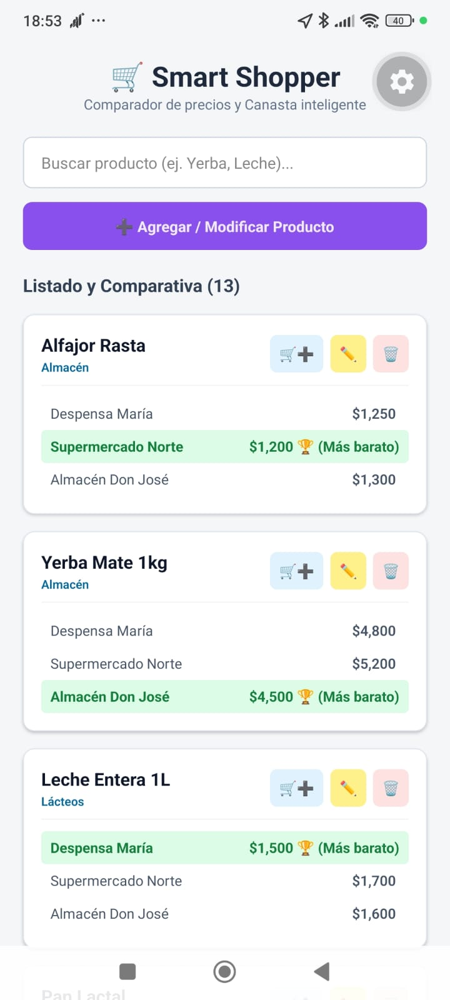

# 🛒 Smart Shopper — Comparador de Precios y Canasta Inteligente

**Smart Shopper** es una aplicación móvil desarrollada con **React Native** y **Expo** diseñada para ayudar a los consumidores a comparar precios de productos de primera necesidad entre distintos comercios de barrio (*Despensa María, Supermercado Norte, Almacén Don José*), identificar las opciones más económicas y calcular el costo total de una canasta de compras.

---

## 🚀 Características Principales

* 🔍 **Búsqueda Dinámica**: Filtrado en tiempo real por nombre de producto.
* 🏆 **Mejor Precio Automático**: Algoritmo que identifica y resalta visualmente la opción más económica para cada producto individual usando operaciones sobre arreglos (`Math.min`).
* ✏️ **Gestión Dinámica de Productos (CRUD Completo)**:
  * Formulario desplegable (*acordeón*) optimizado para dispositivos móviles.
  * Permite **agregar** nuevos productos con sus precios correspondientes por comercio.
  * Permite **editar** información y precios existentes en tiempo real.
  * Permite **eliminar** productos del catálogo.
* 🛍️ **Calculadora de Canasta Inteligente (Funcionalidad Opcional)**:
  * Selección múltiple de productos para armar una lista de compras.
  * Sumatoria automática del costo total por cada comercio.
  * Identificación del supermercado/almacén más barato para realizar la compra completa.
* 📱 **UI/UX Responsive**: Manejo de teclado móvil con `KeyboardAvoidingView` y actualización interactiva con hooks de React (`useState`).

---

## 🛠️ Tecnologías Utilizadas

* **Framework**: React Native (Expo SDK 58)
* **Lenguaje**: JavaScript (ES6+)
* **Gestor de Estado**: React `useState`
* **Plataforma de Pruebas**: Android (Expo Go)
* **Control de Versiones**: Git & GitHub (Flujo de *Feature Branching*)

---

## 📸 Capturas de Pantalla

### 🔍 Comparativa y Canasta
| Listado y Comparativa | Resumen de Canasta Inteligente |
| :---: | :---: |
|  |  |

### ✏️ Formulario CRUD y Carga de Productos
| Formulario Vacío | Carga de Datos | Producto Agregado |
| :---: | :---: | :---: |
|  |  |  |

---

## 📂 Estructura del Proyecto

```text
├── assets/                  # Recursos estáticos (imágenes, fuentes, screenshots)
├── src/
│   └── data.js              # Estado/Estructura inicial de productos y precios
├── App.js                   # Lógica principal, estado local y componentes UI
├── app.json                 # Configuración de Expo
├── package.json             # Dependencias del proyecto
└── README.md                # Documentación del proyecto
```

---
## 📋 Prerrequisitos

Antes de comenzar, asegúrate de tener instalado en tu sistema:

* [Node.js](https://nodejs.org/) (Versión 18.x o superior recomendada)
* [Git](https://git-scm.com/)
* La app **Expo Go** instalada en tu dispositivo móvil (Android/iOS).

## 💻 Instalación y Ejecución Local

1. **Clonar el repositorio:**
```bash
   git clone https://github.com/AstraLord007/smart-shopper.git
   cd smart-shopper
```

2. **Instalar dependencias:**
```bash
npm install
```

3. **Iniciar el servidor de desarrollo:**
```bash
npx expo start
```

4. **Probar en dispositivo físico:**

   * Descarga la app Expo Go desde Google Play Store o App Store.
   * Escanea el código QR desplegado en la terminal.

## 👥 Flujo de Trabajo (Git Workflow)
El proyecto fue desarrollado aplicando un flujo de trabajo profesional por ramas de características (Feature Branches) y Pull Requests:

1. feat/data-layer: Estructuración del modelo de datos inicial.

2. feat/expand-products: Ampliación del catálogo con categorías (Almacén, Lácteos, Bebidas, Limpieza).

3. feat/add-product-form: Implementación del formulario dinámico CRUD y optimización UX de teclado.

4. feat/shopping-cart: Integración del calculador de canasta inteligente de compras.